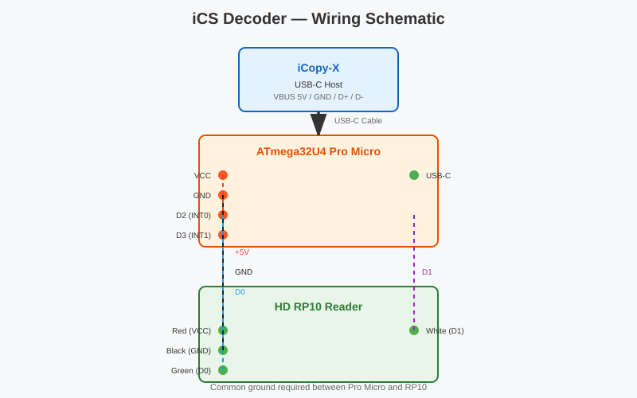
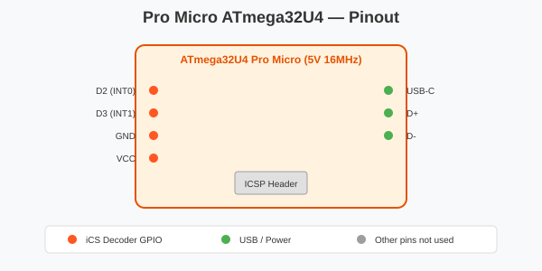

# iCopy-X iCS Decoder

Firmware and middleware to emulate the Lab401 iCS Decoder for the iCopy-X. Reads iCLASS SE / iCLASS SEOS cards via the HD RP10 reader and presents them to the iCopy-X as a USB CDC serial accessory.

## How It Works

### Hardware Layer (ICS Decoder Dongle)
1. RP10 reads iCLASS SE / iCLASS SEOS card via 13.56 MHz interface
2. For SEOS cards: Performs ISO 7816 handshake, challenge-response auth, and EAX decryption
3. Outputs decrypted PACS payload via USB serial ($A_CARD_START$...$A_CARD_STOP$)

### Middleware Layer (iCopy-X)
1. Parses SIO PACS payload with NN right-shift bit extraction
2. Extracts FC/CN from 26-bit Wiegand frame
3. Auto-detects target blank type (HF iClass or LF T5577)
4. Writes credential to blank via PM3 executor

## SEOS SIO Parsing (Black Hat Asia 2025)

SEOS cards do NOT expose credential data in plaintext. The ICS Decoder hardware performs the full cryptographic handshake and decryption.

### NN Right-Shift Extraction

**Format:** `[NN] [Payload Bytes]`
- `NN` = number of trailing zero padding bits (byte 0)
- Right-shift bitstream by NN bits, then parse 26-bit Wiegand frame

**26-bit Wiegand Frame (H10301):**
```
[P_even (1b)] [FC (8b)] [CN (16b)] [P_odd (1b)]
```

**Extraction:**
```python
shift_nn = payload[0]
bitstream = int.from_bytes(payload[1:], byteorder="big")
shifted = bitstream >> shift_nn
fc = (shifted >> 17) & 0xFF      # Facility Code
cn = (shifted >> 1) & 0xFFFF     # Card Number
```

### ASN.1 TLV Container

If decoder outputs raw container (Tag 0x85):
```python
if data[0] == 0x85:
    length = data[1]
    data = data[2:2 + length]
# Then apply NN right-shift as above
```

## Dual-Frequency Target Support

| Target | Frequency | Card Types | Detection | Write Method |
|--------|-----------|------------|-----------|--------------|
| HF iClass | 13.56 MHz | Picopass 2k/16k, Magic iClass | `hf iclass rdbl` | `hf iclass wrbl` |
| LF T5577 | 125 kHz | T5577 (HID Prox) | `lf t55xx detect` | `lf hid clone -w H10301 --fc --cn` |

### HF Write (iClass)
- Uses `iclasswrite.writeDataBlocks()` → `hf iclass wrbl`
- Writes Block 7 (PACS credential) to legacy iClass/Picopass blanks

### LF Write (T5577)
- Uses `lf hid clone -w H10301 --fc {fc} --cn {cn}`
- Lets Proxmark3 handle H10301 framing and parity calculation natively
- **Do NOT use `lf hid clone -r` with manual bit-packing** - causes corrupted cards

## Hardware

| Component | Details |
|-----------|---------|
| MCU | SparkFun Qwiic Pro Micro - USB-C (ATmega32U4) 5V/16MHz |
| RFID Reader | HID multiCLASS SE RP10 / RP40 |
| Connection | USB-C to iCopy-X |

> **Note:** The SparkFun Qwiic Pro Micro has native USB-C and requires no hardware modification.

## Wiring



### Pro Micro Pinout



| Pro Micro Pin | RP10 Wire | Function |
|---------------|-----------|----------|
| VCC | Red | +5V power to reader |
| GND | Black | Common ground |
| Pin 2 (D0, INT0) | Green | Wiegand D0 |
| Pin 3 (D1, INT1) | White | Wiegand D1 |

> Keep D0/D1 leads short (<15 cm) to preserve Wiegand timing integrity. The RP10 draws ~75 mA standby, ~100 mA peak.

## Protocol

The device enumerates as a USB CDC serial port. The iCopy-X communicates with a simple text protocol:

| Direction | Data |
|-----------|------|
| iCopy-X → Device | `Who\r\n` |
| Device → iCopy-X | `ISE\r\n` |
| iCopy-X → Device | `RD\r\n` |
| Device → iCopy-X | `OK\r\n` + `$A_CARD_START$` block, or `??\r\n` |

### Card Payload Format

```
$A_CARD_START$
wiedata#:<binary bitstream>
Bit#:<bit count>
FC#:<facility code>
ID#:<card number>
Hex#:<raw hex padded to byte boundary>
Blk7#:<64-bit zero-padded hex>
Bits#:<48-bit left-padded binary>
SIO#:<decrypted PACS payload with NN prefix>
SIO_CONTAINER#:<raw ASN.1 TLV container>
$A_CARD_STOP$
```

### Field Specifications

| Field | Format | Description |
|-------|--------|-------------|
| `wiedata#:` | ASCII binary | Exact-length binary string matching Wiegand bit count |
| `Bit#:` | Base-10 integer | Total captured bits (26, 34, 35, 37, etc.) |
| `FC#:` | Base-10 integer | Facility code (0 if format has no FC field) |
| `ID#:` | Base-10 integer | Card number |
| `Hex#:` | Zero-padded hex | Raw bits padded to nearest byte boundary |
| `Blk7#:` | 16-char hex | 64-bit zero-padded hex for Proxmark3 block write |
| `Bits#:` | 48-char binary | Left-padded with zeros to 48 characters |
| `SIO#:` | Hex string | Decrypted PACS payload with NN padding byte |
| `SIO_CONTAINER#:` | Hex string | Raw ASN.1 TLV container (Tag 0x85) |

### Padding Notes

- **No artificial bit insertion is used.** Some reverse-engineered implementations add extra padding bits (`+0x2000000000 + (1<<bitnum)`) to Hex# and Bits# fields. This is **not required** by the iCopy-X parser. The confirmed format uses simple zero-padding only.
- `Hex#` is padded to the nearest byte boundary: 26 bits → 8 hex chars, 34 bits → 10 hex chars
- `Blk7#` is always 16 hex chars (64 bits), zero-padded on the left
- `Bits#` is always 48 binary chars, zero-padded on the left

### Example Output (26-bit H10301)

```
$A_CARD_START$
wiedata#:10011001000011000000111001
Bit#:26
FC#:100
ID#:12345
Hex#:02643039
Blk7#:0000000002643039
Bits#:000000000000000000000010011001000011000000111001
$A_CARD_STOP$
```

### Example SEOS SIO Output

```
$A_CARD_START$
Blk7#:00000000029D6BDD
SIO#:061B7D0040
FC#:78
ID#:46574
$A_CARD_STOP$
```

In this example:
- `SIO#:061B7D0040` - Decrypted PACS payload with NN=6 padding bits
- After right-shift by 6: `0x029D6BDD` (26-bit Wiegand frame with parity)
- FC = `(0x029D6BDD >> 17) & 0xFF` = 78
- CN = `(0x029D6BDD >> 1) & 0xFFFF` = 46574

## Release History

### v0.1.6.3 — Proxmark3 v4.23346 (Frosty Lemon) Compatibility Verification

Full empirical validation of all PM3 command dispatches against the upstream
Proxmark3 v4.23346 (Iceman) source tree and Capabilities v11.

#### PM3 Compatibility

All 47 AutoCopy PM3 command dispatch points were verified against the
Proxmark3 v4.23346 source tree at `pm3/proxmark3/client/src/`. Every unique
command template (32 total) was cross-referenced against the actual `CLIParserInit`
and `argtable` definitions in the PM3 C source files.

**Verification results:**
- 47 dispatch points audited (all via direct `executor.startPM3Task` — 0 routed through pm3_compat)
- 32 unique command templates extracted and verified
- 32/32 commands: FULL MATCH
- 0 mismatches, 0 deprecated flags, 0 missing parameters

The audit script `scripts/audit_pm3_cli.py` performs AST-based static analysis
of the extracted ICSDecoder Python source to extract command templates and
response parsers. A compliance matrix comparing AutoCopy dispatches against
PM3 v4.23346 CLI specs is available in `docs/AUTOCOPY_AUDIT_MAP.md`.

#### Commands by Category

| Category | Card Types | Dispatch Points |
|----------|-----------|-----------------|
| LF Clone Writes & Verifications | EM410x, HID, Indala, FDX-B, KERI, NEDAP, T5577, EM4x05, Hitag2/Paxton | 21 |
| HF Mifare Classic | Gen1a (csetuid, cload, wrbl, cgetblk) + Gen2 detection | 14 |
| HF Ultralight / NTAG | MFU restore/info (EV1, NTAG213/215/216, Magic UL) | 3 |
| LF Hitag2 / Paxton | Paxton blocks, Hitag2 authenticated ops | 4 |
| HF iCLASS & ISO15693 | calcnewkey, wrbl, rdbl | 5 |

#### Flag Compatibility Verified

- **`-k` / `--key`**: Used consistently as the key parameter across all
  Hitag2, MIFARE Classic, MFU, and iCLASS commands — no conflict with `--keep`.
- **`-p`**: Maps to `--pwd` on `lf t55xx write`, `lf hitag wrbl`, and
  `lf em 4x05 write` — verified against respective argtable definitions.
- **`--blk`**: Maps to `arg_int1(NULL, "blk", ...)` on `hf mf wrbl`,
  `hf mf cgetblk`, `hf iclass wrbl`, `hf iclass rdbl` — all verified.
- **`-r` / `--raw`**: Used for raw data across LF clone commands
  (HID, Indala, SecuraKey, Gallagher, Paradox, Nexwatch) — verified.

#### CLI Syntax

All PM3 command dispatches use Iceman POSIX-compliant CLI syntax natively.
The AutoCopy engine does not inject any runtime middleware transformations
between the dispatched command and the PM3 client. Commands like `lf sea`
and `hf sea` are valid CLI prefix-match aliases for `lf search` and
`hf search` respectively.

### v0.1.6.2

- ... (previous release notes)

## Build Instructions

### Prerequisites

- Windows 10/11, macOS, or Linux
- Arduino IDE 2.x or PlatformIO
- USB-C cable to connect Pro Micro to PC

### Arduino IDE

1. Install **SparkFun AVR Boards** via Boards Manager (add `https://raw.githubusercontent.com/sparkfun/Arduino_Boards/main/IDE_Board_Manager/package_sparkfun_index.json` in Preferences)
2. Select **Tools → Board → SparkFun AVR Boards → SparkFun Qwiic Pro Micro (ATmega32U4)**
3. Open `firmware/ics-decoder/ics-decoder.ino`
4. Select the correct COM port under **Tools → Port**
5. Click **Upload**

### PlatformIO

```bash
pio run -t upload
```

## iCopy-X Middleware Integration

The iCopy-X middleware (`src/middleware/ics_decoder.py`) handles:

1. **Serial Communication** - Detects ICS Decoder via USB serial
2. **SIO Parsing** - Extracts FC/CN from SEOS PACS payload
3. **Target Detection** - Auto-detects HF iClass or LF T5577 blanks
4. **Write Routing** - Routes to appropriate PM3 write command

### Key Functions

| Function | Purpose |
|----------|---------|
| `detect_decoder()` | Scan serial ports for ICS Decoder |
| `read_card(ser)` | Send RD command, read card block |
| `parse_block(text)` | Parse $A_CARD_START$...$A_CARD_STOP$ block |
| `extract_and_shift_wiegand(data)` | Unified NN right-shift + Wiegand parsing |
| `detect_target()` | Auto-detect target type (HF/LF) |
| `write_to_card(blk7)` | Write to HF iClass blank |
| `write_to_t5577(fc, cn)` | Write to LF T5577 blank |

### PM3 Commands Used

The following commands are dispatched by the AutoCopy engine during credential cloning:

| Command | Purpose |
|---------|---------|
| `hf iclass rdbl --blk {b} -k {key}` | Read iCLASS block for target detection |
| `hf iclass wrbl --blk {b} -d {data} -k {key}` | Write iCLASS block |
| `hf iclass calcnewkey --old {old} --new {new}` | Calculate diversified iCLASS key |
| `hf mf wrbl --blk {b} -a\|-b -k {key} -d {data} --force` | Write MIFARE Classic block |
| `hf mf csetuid -u {uid} --atqa {atqa} --sak {sak}` | Set UID/ATQA/SAK on Gen1a card |
| `hf mf cload -f {file}` | Load dump to Gen1a card |
| `hf mf cgetblk --blk {b}` | Read MIFARE Classic block |
| `hf 14a info` | ISO14443-A card presence/info |
| `hf 14a raw {-flags} {hex}` | Raw 14a commands (Gen1a freeze sequence) |
| `hf mfu info` | MIFARE Ultralight/NTAG info |
| `hf mfu restore -f {file} [-e\|-s\|-k {key}]` | Restore MFU/NTAG dump |
| `lf t55xx write -b {b} -d {data} [-p {pwd}]` | Write T5577 block |
| `lf t55xx restore -f {file}` | Restore T5577 from dump |
| `lf hid clone -r {raw}` | Clone HID Prox to T5577 |
| `lf indala clone -r {raw}` | Clone Indala to T5577 |
| `lf fdxb clone --country {c} --national {n}` | Clone FDX-B to T5577 |
| `lf keri clone -t i --cn {cn}` | Clone KERI to T5577 |
| `lf hitag read --ht2 -k {key}` | Read Hitag2/Paxton |
| `lf hitag wrbl --ht2 -p {p} -d {d} -k {key}` | Write Hitag2/Paxton block |
| `lf securakey clone -r {raw}` | Clone SecuraKey to T5577 |
| `lf em 410x clone --id {id}` | Clone EM410x to T5577 |
| `lf em 4x05 write -a {a} -d {data} -p {pwd}` | Write EM4x05 block |
| `lf em 4x05 read -a {a}` | Read EM4x05 block |
| `lf sea` | LF tag search (alias for `lf search`) |
| `hf sea` | HF tag search (alias for `hf search`) |
| `data save -f {file}` | Save graph buffer to file |
| `hf felica reader` | FeliCa tag reader |
| `hw sync` | Hardware sync |

**IMPORTANT:** `hf iclass info` HANGS on iCopy-X hardware (FPGA mismatch) - DO NOT USE

## Development

### Directory Structure

```
├── firmware/
│   ├── ics-decoder/       # Production iCS Decoder firmware
│   └── wiegand-sniffer/   # Debug tool for validating Wiegand capture
├── release/
│   └── extracted-955/      # Extracted ICSDecoder source (v9.5.5)
├── scripts/
│   └── audit_pm3_cli.py    # PM3 command dispatch audit script
├── docs/
│   ├── build-instructions.md
│   ├── wiring.md
│   └── AUTOCOPY_AUDIT_MAP.md  # AutoCopy PM3 command audit report
├── memory-bank/            # Project research, decisions, progress
├── src/
│   └── middleware/
│       └── ics_decoder.py # iCopy-X middleware (SIO parsing + write routing)
└── README.md
```

### Firmware Variants

- **`ics-decoder`** — Production firmware implementing the complete Who/ISE/RD protocol
- **`wiegand-sniffer`** — Debug tool that outputs raw Wiegand data to Serial Monitor for validation

## License

PolyForm Noncommercial License 1.0.0 — see [LICENSE](LICENSE).

## Disclaimer

This project is for pentesting and RFID research purposes only. The iCS Decoder protocol is proprietary and reverse-engineered. This software cannot be used in a commercial context.
